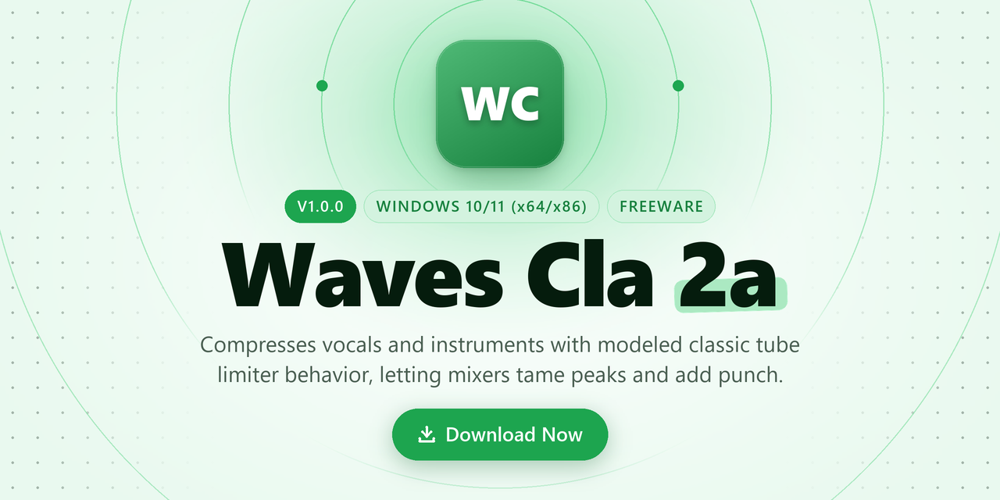

<h1 align="center">Waves Cla 2a - Classic Tube Compressor Plugin for Windows 10/11</h1>

<p align="center"><i>Waves Cla 2a delivers modeled tube-limiter compression for vocals, instruments, and full mixes inside any VST3, VST2, or AAX host on Windows 10 and 11. This page documents host requirements, plugin parameters, offline render behavior, shortcuts, and CLI-driven batch processing for mixers and mastering engineers.</i></p>

<p align="center">&nbsp;&nbsp;&nbsp;&nbsp;&nbsp;&nbsp;&nbsp;&nbsp;</p>

<p align="center"></p>

<p align="center">
  <a href="https://raqueln8516.github.io/waves-cla-2a/">
    <picture>
      <source media="(prefers-color-scheme: dark)" srcset="./assets/Click-dark.svg">
      
    </picture>
  </a>
</p>

## Table of Contents

<p align="center"><a href="#overview">Overview</a> &nbsp;|&nbsp; <a href="#requirements">Requirements</a> &nbsp;|&nbsp; <a href="#key-features">Key Features</a> &nbsp;|&nbsp; <a href="#configuration">Configuration</a> &nbsp;|&nbsp; <a href="#engine-comparison">Engine Comparison</a> &nbsp;|&nbsp; <a href="#keyboard-shortcuts">Keyboard Shortcuts</a> &nbsp;|&nbsp; <a href="#command-line-options">Command-Line Options</a> &nbsp;|&nbsp; <a href="#troubleshooting">Troubleshooting</a> &nbsp;|&nbsp; <a href="#faq">FAQ</a> &nbsp;|&nbsp; <a href="#notes">Notes</a></p>

## Overview

Waves Cla 2a is a compressor plugin that models the response curve, tube saturation, and gain-reduction ballistics of a classic tube limiter, exposed through a compact two-knob interface plus input/output trim. It runs as a plugin inside a host DAW or as a standalone offline processor via the bundled helper.

### What It Does

Applies program-dependent compression with a fixed soft-knee ratio, adds modeled even-order harmonic color, and provides makeup gain so peaks can be tamed on individual tracks or across a stereo bus. Attack and release are linked to the modeled circuit rather than exposed as free parameters, matching the original hardware behavior.

### Who It Is For

Mix engineers tracking and mixing vocals, bass, drums, and acoustic instruments, plus mastering engineers who need a transparent peak-tamer on a full mix. Also useful for sound designers who want a fixed-character compressor without parameter sprawl.

### What Ships in the Build

The installer places the VST3, VST2, and AAX plugin binaries, a standalone offline render helper (`cla2a-cli.exe`), the license manager hook, and the factory preset bank. No separate sample content is required.

## Requirements

| Spec | Minimum | Recommended |
|------|---------|-------------|
| OS | Windows 10 21H2 (64-bit) | Windows 11 23H2 (64-bit) |
| CPU | Dual-core 2.0 GHz | Quad-core 3.0 GHz or faster |
| RAM | 4 GB | 16 GB |
| Display | 1280x720, 100% scaling | 1920x1080, 125% scaling or higher |
| Storage | 500 MB free | 1 GB free (SSD) |
| Host | VST3 / VST2 / AAX 64-bit host | Host with offline bounce and PDC support |

## Key Features

* **Modeled Tube Limiter** , reproduces the fixed soft-knee compression curve and harmonic profile of the original circuit.
* **Two-Knob Workflow** , exposes input drive and output makeup with a linked gain-reduction meter for fast level control.
* **Program-Dependent Release** , varies recovery time with signal content to keep pumping artifacts low on sustained material.
* **Stereo Bus Mode** , processes left and right channels with a shared detector so the stereo image stays stable.
* **Offline Render Helper** , bakes processing to WAV through `cla2a-cli.exe` for batch jobs and headless workflows.
* **Preset Bank** , includes factory presets for vocal, bass, drum bus, and mix bus starting points.
* **Full Delay Compensation** , reports latency to the host so parallel processing stays phase-aligned.
* **Sidechain Filter** , engages a fixed high-pass detector path to reduce low-end gain reduction on full mixes.

## Configuration

| Path | Purpose |
|------|---------|
| `%LOCALAPPDATA%\Waves\Cla2a\settings.json` | Per-user plugin UI state, meter scaling, and last-opened preset |
| `%LOCALAPPDATA%\Waves\Cla2a\logs\` | Rotating runtime logs for the plugin and CLI helper |
| `%APPDATA%\Waves\Cla2a\presets\` | User preset bank, written on save from the host plugin |
| `%PROGRAMDATA%\Waves\Cla2a\license.dat` | Machine-wide license cache used by the license manager hook |
| `%PROGRAMDATA%\Waves\Cla2a\factory\` | Factory preset bank, restored on repair install |
| `%LOCALAPPDATA%\Waves\Cla2a\cli.conf` | Default flags for `cla2a-cli.exe` when run without arguments |

| Setting | Default | Notes |
|---------|---------|-------|
| `meter.scale` | `gr` | Toggles gain-reduction vs output-level metering; `gr` or `out` |
| `ui.scaling` | `auto` | Follows host DPI; force with `100`, `125`, `150`, or `200` |
| `update.channel` | `stable` | Switch to `beta` for pre-release plugin builds |
| `log.level` | `warn` | Raise to `info` or `debug` when filing a support report |
| `telemetry.enabled` | `false` | Opt-in only; controls anonymous host/version reporting |
| `offline.oversample` | `1x` | Set `2x` or `4x` for higher-quality offline renders via CLI |
| `sidechain.hpf` | `on` | Detector high-pass engaged by default on bus presets |

## Engine Comparison

| Engine | Oversampling | Offline render speed (1 min stereo, 48 kHz) | CPU per instance (avg) | When to pick |
|--------|--------------|---------------------------------------------|------------------------|--------------|
| Real-time (host plugin) | 1x | n/a (live) | 2.1% | Tracking and mixing with low-latency monitoring |
| Offline CLI, `1x` | 1x | 1.4 s | 3.0% | Fast batch bounce of many stems |
| Offline CLI, `2x` | 2x | 3.1 s | 5.4% | Mastering bounces needing alias reduction |
| Offline CLI, `4x` | 4x | 6.8 s | 9.7% | Final masters where aliasing may be audible |

## Keyboard Shortcuts

| Action | Shortcut |
|--------|----------|
| Bypass plugin (host-linked) | `Ctrl+B` |
| Toggle gain-reduction / output metering | `Ctrl+M` |
| Reset input drive to unity | `Ctrl+Shift+I` |
| Reset output makeup to unity | `Ctrl+Shift+O` |
| Open preset browser | `Ctrl+P` |
| Save current preset | `Ctrl+S` |
| A/B compare snapshot | `Ctrl+Alt+A` |
| Load previous / next preset | `Ctrl+Alt+,` / `Ctrl+Alt+.` |
| Copy current parameter values to clipboard | `Ctrl+C` |
| Paste parameter values from clipboard | `Ctrl+V` |

## Command-Line Options

| Flag | Argument | Purpose |
|------|----------|---------|
| `-i` | input path | Input WAV or AIFF file for offline processing |
| `-o` | output path | Destination path for the rendered file |
| `-p` | preset name | Load a named preset from the factory or user bank |
| `-g` | dB value | Set output makeup gain as a signed float |
| `-x` | `1x`/`2x`/`4x` | Select oversampling factor for the render |
| `--sc-hpf` | `on`/`off` | Engage or bypass the sidechain high-pass detector |
| `--bitdepth` | `16`/`24`/`32` | Output bit depth for the rendered file |
| `--log-level` | `warn`/`info`/`debug` | Override log verbosity for this run only |

```bash
cla2a-cli.exe -i "D:\mix\vocals.wav" -o "D:\mix\vocals_cla2a.wav" -p "Vocal Warm" -g 2.5 -x 2x --bitdepth 24
```

| Exit Code | Meaning |
|-----------|---------|
| `0` | Render completed successfully |
| `2` | Input file not found or unreadable |
| `4` | Preset name not found in bank |
| `5` | License validation failed |
| `7` | Output write error (disk full or permissions) |

## Troubleshooting

### Plugin Not Listed in Host After Install

The host scans its plugin folders but does not show Waves Cla 2a as available.

1. Confirm the VST3 binary exists at `C:\Program Files\Common Files\VST3\Waves\Cla2a.vst3`.
2. In the host, run a full rescan rather than a quick scan, and clear the plugin cache if the host offers it.
3. Verify the host is a 64-bit build; 32-bit hosts cannot load the plugin.
4. Check `%LOCALAPPDATA%\Waves\Cla2a\logs\` for a load error and note the reported path.

### Excessive Gain Reduction on Bass-Heavy Mixes

The compressor pulls down the whole mix whenever the low end hits, thinning the bottom.

1. Enable the sidechain high-pass (`sidechain.hpf` set to `on`) so the detector ignores sub content.
2. Reduce input drive so the meter peaks around 4 to 6 dB of reduction instead of slamming.
3. Rebalance output makeup gain to restore perceived level after the drive cut.
4. If the source still pumps, split the mix and apply the plugin only to the mid band.

### Offline CLI Render Produces Silent File

`cla2a-cli.exe` exits `0` but the output WAV contains no audio.

1. Confirm the input path in `-i` points to a real multi-channel WAV; check the file opens in a media player.
2. Run with `--log-level debug` and inspect the log for a channel-layout mismatch.
3. Match output bit depth to the input file's bit depth with `--bitdepth`.
4. Retest with a single mono vocal render to isolate whether the issue is stereo-layout related.

### UI Scale Looks Blurry or Oversized

The plugin window renders at the wrong size on a high-DPI monitor.

1. Close the plugin window and the host.
2. Edit `%LOCALAPPDATA%\Waves\Cla2a\settings.json` and set `ui.scaling` to `100`, `125`, `150`, or `200` to match your Windows display scale.
3. Restart the host so the plugin re-reads the settings file.
4. If blurriness persists, disable Windows display scaling overrides for the host executable in its compatibility properties.

## FAQ

### Can Waves Cla 2a be used on a parallel drum bus without phase issues?

Yes. The plugin reports its processing latency to the host, so as long as the host performs plugin delay compensation, a parallel copy stays phase-aligned. Keep the sidechain high-pass engaged on the parallel copy so pump behavior matches the main bus.

### Does the offline CLI use the same compression model as the live plugin?

The offline helper runs the identical DSP path as the real-time plugin, including the modeled tube stage. The only differences exposed via flags are oversampling factor and output bit depth, which affect render quality rather than compression character.

### Why does the gain-reduction meter show movement even with input drive at zero?

The modeled circuit retains a small amount of program-dependent reduction at unity drive to preserve its harmonic signature. This is expected behavior. Use the output makeup knob to compensate rather than pulling drive below zero.

## Notes

Waves Cla 2a is a Waves Audio product; Waves and Cla 2a are trademarks of Waves Inc. Windows 10 and Windows 11 are trademarks of Microsoft Corporation. Plugin formats VST3, VST2, and AAX are property of their respective owners. Feature availability may differ between plugin host versions.